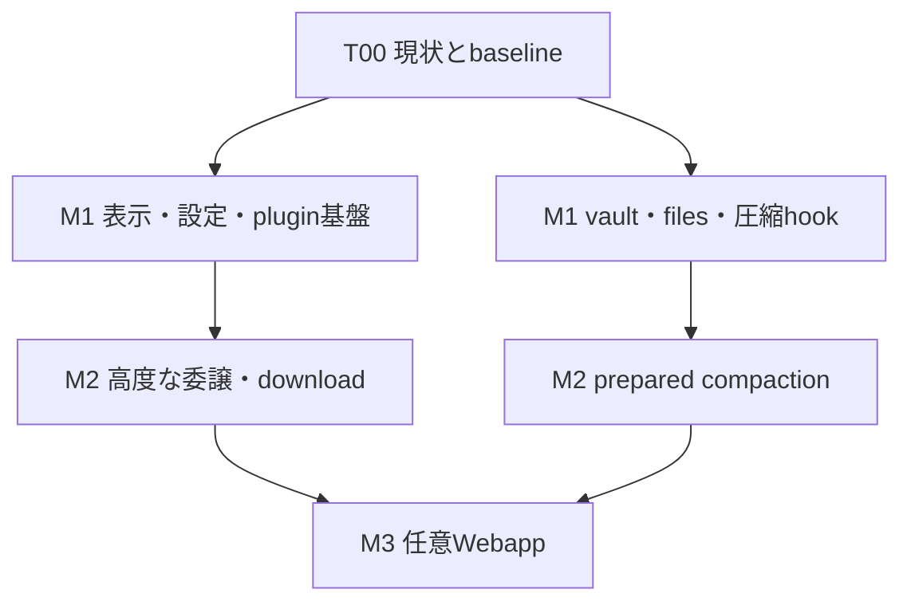

# WindowsネイティブHermes 新機能導入 — Cursor Implementation Plan

> **For agentic workers:** 利用可能なら `superpowers:subagent-driven-development`、逐次実行なら `superpowers:executing-plans` を使う。実行環境にスキルがない場合も、本書のチェックリストと検証順序に従う。Cursorは一つのタスクをRED→最小実装→GREEN→対象回帰→必要なmutation→Windows検証→レビューの順に完了する。

**作成日：** 2026-10-28 JST  
**状態：** 実装計画。リポジトリの変更、CodeGraphの実行、テスト、Windows実機検証は本書作成時点では未実施。  
**Goal：** Windows版の既存機能を保持しながら、上流にある価値の高い機能を、下流の所有境界とネイティブ動作へ合わせて導入する。  
**Architecture：** Python backendがagent/session/圧縮を所有し、Electron mainがDesktopのnative権限とlifecycleを所有する。既存plugin・設定・イベント経路を拡張する。  
**Tech Stack：** Python >=3.11,<3.14、既存uv lock、React 19 / TypeScript / Nanostores / Electron、既存npm workspace、PowerShell、Windows 11。正確なバージョンは着手時のlockfileを採用する。  
**Spec：** [SPEC_WINDOWS_NATIVE_20261028.md](SPEC_WINDOWS_NATIVE_20261028.md)  
**検証対応表：** [ACCEPTANCE_MATRIX.md](ACCEPTANCE_MATRIX.md)  
**開始用プロンプト：** [CURSOR_START_HERE.md](CURSOR_START_HERE.md)

## 1. 成果と作業範囲

本計画の成果は「MCP処理の正しい進捗」「子agent設定GUI」「plugin更新・認証・選択UI」「Windows資格情報保管」「pluginフォルダーAPI」「圧縮後hook」から成るM1と、その後の選択的なM2/M3である。コミット数や上流との行数差をKPIにしない。既存の同等機能には実装を追加せず、必要な受け入れ条件を確認して完了とする。

Cursorは機能単位でreview可能な差分を作る。独立した機能は別ブランチ/PR候補にできるが、mainへのpush、公開、ユーザーが使うDesktop/llama-serverの停止・置換・再起動は本書だけでは実施しない。実装中の承認が必要な場合も、まず差分・テスト結果・適用手順を具体化する。

### 1.1 調査固定点

| 対象 | 値 | 扱い |
|---|---|---|
| 下流repository | `zapabob/hermes-agent-windows` | Windows固有の契約を正とする |
| 下流調査SHA | `5531c849b424cdfee17946935eec73363917e5e7` | Cursorの実checkoutと照合する |
| 上流repository | `NousResearch/hermes-agent` | 機能の意味論とテストを参照する |
| 上流参照SHA | `e5ea5fd9ccdf2913c0b21b24eb3d22b321d2e2a6` | main全体をmergeしない |
| 上流最新正式release確認 | `v0.22.5` / `bf0203a794a07aac3ff764972ab9087baa4e4f4e` | 公開は2026-10-23 14:28 JST。main限定機能をrelease済みと表記しない |
| 下流READMEのsource version | `0.22.0` | 機能の実装有無やinstaller配布の証拠とは別 |
| 旧campaign | `.codex/UPSTREAM_SNAPSHOT.json` | 過去の範囲を保存。本campaignの記録を別に作る |

調査は固定SHAのコード、テスト定義、規約の読取りに基づく。ファイルの存在は試験の成功を意味しない。検索で見つからない機能は「調査した経路では未確認」とし、T00で実機checkoutをCodeGraphから確認してから新設する。根拠は末尾の参照と `SOURCE_EVIDENCE.json` に保存した。

### 1.2 現状と必要な差分

| 機能 | 確認した現状 | 今回の扱い |
|---|---|---|
| キュー編集・Steer Now・park・背景drain | Desktopとgatewayに実装済み | T02で接続scope・ACK喪失等の境界だけ照合 |
| local prefillの計測・timeout延長・同route復旧 | 実装済み | T02で要求に対応した表示へ接続。計測器を作り直さない |
| MCP進捗 | SDK callbackとgatewayの一般進捗bridgeが不足。Desktop受信は既存 | T01で不足する線をつなぐ |
| 通常delegationのprovider/model/fallback/limits | backendに既存 | T03で専用GUIと原子的保存 |
| controlled delegation | 親所有routeの固定とoverride拒否が既存 | T03/T04の必須回帰 |
| role/profile別backend route | 対象delegate_toolに `delegation.backend` は未確認 | T04として分離、既存admissionを利用 |
| plugin更新 | CLI/GUI双方あり。GUI側にCLI相当のscan/再同意がない | T05で共通処理を整えてから更新UX |
| plugin OAuth / ask_choice | 対象hostには未確認 | T06/T07。既存auth/clarifyを拡張 |
| vault | file鍵＋Windows DACLが既存 | T08でopt-in keychainと往復移行 |
| Desktop ctx.files | `PluginContext`に未定義 | T09で狭いIPCとgrant APIを追加 |
| post_compaction | durable通知の接続点あり、plugin hook未確認 | T10でcommit後の観測hook |
| prepared compaction | 対象compressor/hostに未確認 | T11、既定OFF・同一GPU保護 |
| モデル取得 | 個別download scriptあり、汎用job manager未確認 | T12で最小manager。上流PM全体は移植しない |
| sleep復帰 | monotonic clock・復旧経路は既存、awake clockは未確認 | T13で実機再現した場合だけ変更 |
| browser Webapp | 上流main限定の大きい機能 | T14。local限定の後続段階 |

## 2. Global Constraints

1. **既存契約を保持する。** 下流の実装router、MoA、fallback、deferred toolsets、memory provider、KV見積もり、圧縮commit fence、Control MCPの本番書込み制限を維持する。機能名が似ていても別のownerを追加しない。
2. **CodeGraphから着手する。** 実checkoutの `status` / `sync` / `query` / `explore` / `impact` を取得する。remote調査を実行結果の代用にしない。定義・呼出し元・書込み先・テストを確認する。
3. **scopeを機能ごとに決める。** profile/connection/session/runtime/lineage/request/generationを混同しない。古い応答は現在のUI・設定・履歴に反映しない。ctx.filesのgrantはDesktop-local・plugin ID別であり、profile別とは扱わない。
4. **設定・データは既存のatomic writerへ。** read→validate→merge→saveを一つのmutation区間で行う。無関係な設定を失わず、失敗で成功表示にしない。
5. **prompt cacheと実行中turnを守る。** tool schemaやbackend切替は新sessionを標準とする。既存の明示的な安全境界での適用だけを使う。進行中childのrouteを変更しない。
6. **Windows nativeで証明する。** WSL/Bashの成功だけでは完了にしない。OS試験は既存の `@pytest.mark.windows_only` 方式を使う。`sys.platform` の偽装を実機証拠にしない。
7. **ローカル資源を尊重する。** Windows 11 / RTX 5060 Ti 16GB / RAM 32GBを想定し、開始時に実測する。Python試験は最初2worker。ディスク空きを確認してから依存やモデルを取得する。不要なnode_modules/モデル複製を作らない。
8. **既存推論binaryを保護する。** カスタムllama-serverとPQ2_0等の実対応を能力確認する。モデル取得機能にruntime更新や再起動を結合しない。
9. **テストは行動を検証する。** source文字列・catalog件数・実装をなぞるassertionを受け入れ根拠にしない。timeout/import失敗をmutation killに数えない。
10. **作業を局所化する。** dirty worktreeを保存し、`reset --hard`、`git clean`、無差別stash削除、`git add -A`を使わない。生成物、secret、`.codegraph`をcommitしない。UTF-8 BOMなし、既存のlint/型規則へ従う。
11. **UIを整える。** Desktopの `AGENTS.md` / `DESIGN.md` を読み、既存の日本語を含むlocale構成を更新する。選択だけで保存しない。入力中のfocusを背景イベントで奪わない。
12. **権限の追加を機能へ結びつける。** OAuth/ファイル/資格情報の権限は必要なscopeだけにする。ベンダー固有signinを新たな必須条件にしない。既存のplugin admissionを回避しない。

## 3. Review Focus

- controlled childへGUI/route pluginからoverrideが流入しないか。
- MCPやprefillの進捗が他profile、別call、別slotへ表示されないか。
- plugin更新のCLI/GUIが同一の検査・再同意を通るか。
- vault移行のどの失敗点でも最後に復号できた鍵を保てるか。
- ctx.filesが自分のAPI範囲を越えるsandbox保証をしていないか。
- compaction hookが外側のdurable commitより先に発火しないか。
- prepared summaryの採用で履歴編集・live tail・cancel・GPU占有が守られるか。
- 既存上流取込キャンペーン、Desktop owner、カスタムモデルruntimeを誤って置換しないか。

## 4. 実装順序と依存

| 段階 | タスク | 依存 | 区分 |
|---|---|---|---|
| 0 | T00 現checkout照合とbaseline | なし | 全体の開始gate |
| 1 | T01 MCP進捗、T02 既存queue/prefill境界、T03 子agent GUI | T00 | M1 |
| 2 | T05 plugin更新、T06 OAuth、T07 choice | T00。T06/T07の露出前にT05で更新時の追加権限を確認 | M1 |
| 3 | T08 vault keychain、T09 ctx.files | T00。plugin API導入時のgrant通知はT05と整合 | M1 |
| 4 | T10 post_compaction | T00＋圧縮baseline | M1 |
| 5 | T04 高度な委譲route、T11 prepared compaction、T12 download、T13 sleep | T03/T10等の個別依存 | M2 |
| 6 | T14 local Webapp、任意機能 | M1/M2との境界を確認 | M3 |

T01/T08/T05等の独立した読取り・実装は分担可能。ただし `tui_gateway/server.py`、`hermes_cli/plugins.py`、`agent/conversation_compression.py` を複数workerが同時編集しない。共通ファイルの担当を一人に決める。



## 5. 共通の実行・証跡ルール

### 5.1 作業場所と記録

想定canonical checkoutは `C:\Users\downl\Documents\New project\hermes-agent`。パスはT00で実在とownerを確認する。計画一式を置く提案先は `docs/windows/feature-intake-20261028/`。本書作成時にはrepositoryへ配置していない。

今回のmanifestは、たとえば `docs/windows/feature-intake-20261028/source-lock.json` を**新設**する。実checkout SHA・dirty差分の有無・参照上流SHA・タスク別採否を保存する。既存のUPSTREAM_SNAPSHOTやstable基準を置換しない。実行ログは `output/reports/feature-intake-20261028/`、個別作業メモは既存規約の `_docs/` を利用し、後者を勝手にcommitしない。

各タスクの記録には、要件ID、実HEAD、実行コマンド、exit code、fixture、REDの失敗理由、GREEN、対象回帰、mutation結果、Windows結果、未実施理由、rollbackを含める。token・鍵・会話本文を証跡に収集しない。

### 5.2 検証コマンド

以下は調査SHAで存在を確認したscriptsを使う。PowerShellでrepository rootから実行する。環境の初回作成はT00でlockfile・既存venv・ディスクを確認して行う。`--no-sync` は環境が準備できている前提。

```powershell
# Python: 各ファイルを別processで実行。REDとmutationではretryしない。
uv run --no-sync python scripts/run_tests_parallel.py --jobs 2 --file-retries 0 tests/agent/test_aux_local_prompt_progress.py -- -q

# 複数ファイルはWindowsの区切りで渡せる。
uv run --no-sync python scripts/run_tests_parallel.py --jobs 2 --file-retries 0 --files 'tests/agent/test_aux_local_prompt_progress.py;tests/agent/test_native_aux_prompt_progress.py' -- -q

# Desktop: 必ず対象ファイルを先に実行する。
npm --workspace apps/desktop run test:ui -- src/store/composer-queue.test.ts
npm --workspace apps/desktop run test:desktop:platforms -- electron/desktop-plugin-install.test.ts
npm --workspace apps/desktop run typecheck

# 実装後、freezeした基準とのWindows footgunチェック。
uv run --no-sync python scripts/check-windows-footguns.py --diff 5531c849b424cdfee17946935eec73363917e5e7

# Native E2Eを対象specだけで実行。専用fixtureを用意してから実行。
npm --workspace apps/desktop run build
npm exec --workspace apps/desktop -- playwright test e2e/queue-turn-boundary.spec.ts
```

T00で実HEADが異なる場合、diff基準は記録した開始SHAへ置換する。新設するテストファイルを実行するときは、本書の例のパスをそのファイルへ置換する。引用したnpm scriptsは `apps/desktop/package.json`、Python runnerの引数は `scripts/run_tests_parallel.py` に基づく。Playwrightは最初に同じ呼出しへ `--list` を付け、対象specだけを収集することを確認する。既存 `test:e2e` はscript内に `e2e/` を指定しているため、追加引数で一つのspecに限定できるとは扱わない。全E2Eを意図するときだけ既存scriptを使う。

Windowsの資格検証は、isolated環境で次の既存scriptを使える。パラメーターの意味と現HEADの実装を先に読む。

```powershell
pwsh -NoProfile -File scripts/windows/Test-HermesWindowsQualification.ps1 -RepoRoot $repoRoot -OutputDirectory $qualificationOutput -Scope ci
```

`$repoRoot` と `$qualificationOutput` はT00で確定したタスク専用変数を使う。installer/portable/workstationまで試す場合は、そのartifactと `-Scope real_workstation` / `-WorkstationEvidencePath` 等の実在パラメーターを明示する。ci scopeの成功をユーザー実機の成功と読み替えない。

### 5.3 タスク共通の完了順序

- [ ] 関連 `AGENTS.md`、CodeGraph impact、既存テストを読む。
- [ ] 受け入れ条件を具体的な入力・競合順序・期待結果にする。
- [ ] 不足する行動テストを先に追加する。既にGREENなら新規実装を省く。REDを無理に作らない。
- [ ] REDが対象機能の不足であることを確認する。import/fixture/ネットワーク失敗はRED達成ではない。
- [ ] 最小実装でGREENにする。既存のwriter/owner/routeを再利用する。
- [ ] 対象の回帰、型・lint、必要なnative OS試験を実行する。
- [ ] データ破壊、権限、非同期ownerに関わる契約は、下記の具体的mutationでテスト強度を確認する。
- [ ] 対象Windows E2Eとrollbackを検証し、影響範囲をレビューする。
- [ ] 実行結果と未実施を記録して、意味のある差分だけをcommit候補にする。

### 5.4 Mutationの実施方法

既存 `scripts/ci/engineering_repair_mutations.py` は特定の修復用であり、任意の新機能へそのまま使える汎用runnerではない。その使い捨てcopy・baseline確認・契約ごとの破壊という方式を再利用する。必要なら **新設案** `scripts/ci/windows_feature_mutations.py` と、タスク別の変異定義を作る。追加の大きなmutation framework導入は必須にしない。

各mutantはfixtureと対象テストを限定し、元コードとcopyがGREENであることを先に確認する。置換位置の一致を検証し、syntax/import/collection failure、timeout、process crashを `INVALID` とする。期待したassertionが破れた場合だけ `KILLED`。通ったものは `SURVIVED` としてテストまたは契約を修正する。同等変異は根拠付き `EQUIVALENT`。全repositoryの架空のmutation scoreを要求しない。単なる色・文言・並び順の変更にはmutationを増設しない。

## 6. タスク詳細

### T00 — 現checkoutの照合とbaseline

**目的：** 実装済み機能を作り直さず、現在のownerと試験環境を確定する。全タスクの前提。

**読む既存ファイル：** root `AGENTS.md`、`DOWNSTREAM_POLICY.md`、`apps/desktop/AGENTS.md` / `DESIGN.md`、`fork/AGENTS.md`と対象下位規約、`README.md`、`FEATURES.md`、`pyproject.toml`、root/desktopの `package.json`、`.github/workflows/fork-cicd.yml`。

- [ ] `git status --short`、`git rev-parse HEAD`、remote、現在branchを記録する。上流に合わせるためのreset/mergeを行わない。開始SHAと異なる場合は差分の影響だけ再調査する。
- [ ] CodeGraphの既存installとlockを確認する。`.tools/codegraph-cli/package.json` の依存を勝手に更新しない。既存CLIを優先し、未導入時だけ同じlock/版で準備する。規約のコマンド形は以下。

```powershell
npx --yes @colbymchenry/codegraph status .
npx --yes @colbymchenry/codegraph sync .
npx --yes @colbymchenry/codegraph query _on_tool_progress
npx --yes @colbymchenry/codegraph explore delegation
npx --yes @colbymchenry/codegraph impact compress_context
```

`npx --yes` が未導入packageを最新へ解決する状態なら、そのまま実行せず既存lockに合うローカルCLIへ置換する。規約にあるquery/explore/impactの対象はタスクごとに変える。外部コードの追加取得を伴わない既存CLIでの読取りから進める。

- [ ] 各要件を `EXISTS_EQUIVALENT / PARTIAL / MISSING / BLOCKED / DEFERRED` に分類する。既存symbol・呼出し元・書込み先・テスト・不足する行動を一行に対応付ける。現状維持だけの行に実装用タスクを増やさない。
- [ ] Windows、CPU/GPU/VRAM/RAM、driver、ディスク空き、Python/Node/npm/uv、llama-serverのbuild/対応GGUF、既存context/slots/KV、Desktop artifact hashを記録する。API key・token・全環境変数は取得しない。
- [ ] 再利用可能な既存venv/依存とnative試験fixtureを確認する。新しい `.venv` やnode_modulesをworktreeごとに複製しない。必要な変更は既存lockに従う。
- [ ] 対象testのbaselineを実行して、既存失敗を区別する。出荷の必須gateが既存失敗で止まる場合も隠さず、対象修正と別件を区別する。
- [ ] 規約の世代差を記録する。Desktop destructive backend ownerは現在の実装・FEATURESにあるElectron mainを基準にし、古いwatchdog owner記述を根拠にownerを復活させない。モデル再起動についても運用規約と実コードを確認し、本番の自動再起動を計画の前提にしない。

**DONE：** source-lock、機能gap表、owner表、実行可能な試験コマンド、baseline/未実施理由が揃う。CodeGraphが使えなければ、変更範囲を確定できる読取りを進めつつ、広範な所有境界refactorは `BLOCKED` とする。新機能が見つからないという理由だけで新しいframeworkを作らない。

### T01 — MCP progressを呼出し単位でDesktopまで接続

**要件：** R01。**M1 / 優先高。**

**既存接続点：** `tools/mcp_tool.py` の `_call` / `server.session.call_tool`、`_admit_mcp_rpc`、`tui_gateway/server.py::_on_tool_progress`、`apps/desktop/src/app/session/hooks/use-message-stream/gateway-event/tools.ts::handleToolEvent`。Desktopには `tool.progress` の受信がある。

**新設テスト案：** `tests/tools/test_mcp_progress.py`、`tests/tui_gateway/test_mcp_progress_events.py`、`apps/desktop/src/app/session/hooks/use-message-stream/mcp-progress-event.test.tsx`。これらは提案名であり、現存testをT00で見つけた場合はそちらへ追加する。

**契約：** SDKの実際のcallback signatureをlockfileの版で確認する。既存tool event envelopeにcall ID / request generationを保持し、profile/connection epochは既存のrouting contextから受け取る。`progress` は有限の非負数、`total` は任意の有効な正数、`message` は上限付き文字列。不正値で処理を落とさない。total不明は不確定表示にする。

- [ ] **RED：** 実MCP SDKに接続するfixture serverで、並行するcall A/B、同名serverの別profile、progressなしserverを動かす。途中progressが正しいcallへ届き、結果本文や成功扱いにならないことをassertする。
- [ ] **RED：** cancel/complete後、reconnect前のcallback、NaN/無限大/不正total/長いmessageを注入し、terminal行がrunningへ戻らないことをassertする。
- [ ] **実装：** 呼出しごとのclosureをcallbackに渡し、完了/取消で閉じる。共有pending-call変数をownerにしない。gatewayの一般progress branchを追加し、既存Desktop行へ配送する。coalesceしてもterminalは即時に反映する。
- [ ] **互換：** callback対応の検出は実行前に済ませる。実行後のTypeErrorを捕まえて同じtoolを呼び直さない。disconnectで副作用callを自動replayしない。
- [ ] **回帰：** 既存 `test_mcp_cancelled_error_propagation.py`、`test_mcp_multiplex_connection_keys.py`、`test_mcp_stdio_fastfail_reconnect.py`、`test_mcp_tool_session_expired.py`、`test_mcp_saved_policy_boundaries.py` をCodeGraphで正確なtestsパスへ解決し、対象runnerで実行する。
- [ ] **Mutation：** call ID比較を外す／closed判定を外す／callback未対応時に再実行する、の各変異を対応testが落とす。
- [ ] **Windows E2E：** stdio fixtureをPowerShell/native Pythonから起動し、Desktopで2call並行→片方cancel→reconnectを検証する。画面上の正しい帰属・完了とfixture側の実行回数を双方assertする。

**Rollback：** progressの送受信だけを止める。MCP呼出しと既存cancel/transport policyは維持する。

### T02 — 既存queueとlocal prefillの識別境界を固める

**要件：** R01と既存機能維持。**M1。新規queue UIは作らない。**

**既存queue：** `src/store/composer-queue.ts`、`src/app/chat/composer/hooks/use-composer-queue.ts`、`queue-panel.tsx`、`src/app/session/hooks/use-background-queue-drain.ts`、`use-prompt-actions/submit.ts`（いずれも `apps/desktop/` 配下）。`tui_gateway/server.py` の `_enqueue_prompt` / `_try_session_steer` / `_drain_queued_prompt` と `methods_session.py`。

**既存prefill：** `agent/local_prompt_progress.py`、`agent/chat_completion_helpers.py::_LlamaProgressTracker` / `_poll_local_llama_progress`、`agent/auxiliary_client.py`、`run_agent.py::AIAgent._emit_wait_notice`、Desktop `src/store/provider-wait.ts` と `gateway-event/message-stream.ts`。

- [ ] **queue照合：** 別connectionに同名profile/同じ保存session IDを用意し、切替後の古いPromise・同entry二重click・送信中edit/delete・圧縮lineage移行を試す。すでにGREENなら境界を記録するだけにする。
- [ ] **ACK喪失：** serverは受理したがACKだけ落とすfixtureを追加する。既存entry IDがwireへ渡らないことだけで重複バグと断定しない。REDなら **新設案**として既存 `prompt.submit` にrequest identityと受理結果照合を追加する。受理不明の内容を新IDに変えて自動再送しない。二重受理を防いでも外部toolのexactly-once実行まで保証したとは書かない。
- [ ] **prefill RED：** 同じserverの要求A/Bを並行にし、Bのactive slotが先頭となるfixtureでAにBのtoken値を表示しないことを試す。
- [ ] **実装：** 検証済みSSEの要求単位progressから表示用callbackを出す。既存のclock/deadline計算は変更しない。`/slots` しか利用できずrequestとslotの対応が分からなければ、不確定の待機表示へ戻す。SSEがある経路へ別pollerを増設しない。
- [ ] **回帰：** queueの既存unit、`queue-turn-boundary.spec.ts`、`session-compression-and-queue-stop.spec.ts`、`steer-alias-contract.spec.ts`、Python `tests/run_agent/test_local_prompt_progress.py` / `tests/agent/test_aux_local_prompt_progress.py` / `test_native_aux_prompt_progress.py` / `tests/test_local_llama_progress.py`、Desktop `provider-wait-event.test.tsx` を対象範囲に合わせて実行する。
- [ ] **Mutation（差分がある場合）：** profile/generation比較削除、accepted前のqueue削除、先頭active slotの無条件採用、closed fenceの迂回を行動testが検出する。
- [ ] **Windows E2E：** 2profile、2call、Stop→park→Resume、圧縮後lineage、接続切替、ACK喪失を専用fixtureで通す。real token/reasoning/tool/terminalが届けばwait表示が消える。

**DONE：** 現行機能の有効な挙動を保持し、確認された不足だけ修正。queue persistenceの実際の範囲を記録し、未検証のgateway restart耐性を保証しない。

### T03 — 既存delegation設定のDesktop GUIと原子的Apply

**要件：** R02。**M1 / 優先高。**

**既存接続点：** `apps/desktop/src/app/settings/model-settings.tsx::ModelSettings` / `profileEpoch`、`src/api/models.ts` / `src/types/hermes.ts`、`tools/delegate_tool.py::_load_config` / `_resolve_delegation_credentials` / `_resolve_child_fallback_chain` / `_build_child_agent`、`hermes_cli/web_server.py::_CONFIG_MUTATION_LOCK` / `update_config` / `_profile_scope`、`hermes_cli/config.py::atomic_config_write` / `save_config`。

**新設案：** `apps/desktop/src/app/settings/subagent-settings.tsx` と同名test。既存 `/api/model/set` のscopeはmain/auxiliaryなので、subagentが既に扱えると仮定しない。

**設定契約：** 実際の `delegation` keyをT00で列挙する。provider/model/base URL/fallback/並列数/timeout/深さ等を一つのdraftとして編集する。inherit、明示pin、明示fallback chain、空配列によるfallback無効を区別する。secret文字列をdraftへ持ち出さない。

- [ ] **RED：** provider選択だけでは保存されない、完全なdraftのApply一回で全項目を保存する、不正model/provider/limits/fallbackは一つも保存しない、save失敗時draftが残る、をtestする。
- [ ] **RED：** profileを切り替えてから旧Apply応答を到着させる。同時に無関係な設定を保存する。新profile/新draft/別keyが古い応答やmergeで失われないことをassertする。
- [ ] **実装：** 既存config endpointにdelegation全体の検証が足りなければ狭いvalidatorを追加する。endpointを新設する場合だけtyped request/responseを追加し、既存mutation lockの中でread→validate→merge→atomic saveを行う。UIのみで検証を済ませない。
- [ ] **反映時点：** 設定をruntime-onlyとschema/tool capabilityに影響するものへ分類する。既存 `_build_tasks_param_description` / `_build_top_level_description` / `_build_dynamic_schema_overrides` は並列数・深さ・orchestrator等をschemaへ反映するため、これらは新sessionを標準の適用先とする。保存済みdraftとsessionの有効設定snapshotを分け、schema・表示・admissionを同じsnapshotへ揃える。runtime-onlyと証明した項目だけ次のchild admissionへ反映し、現在のchildのrouteは保つ。controlled modeには親route固定を表示する。
- [ ] **schema回帰：** 実行中sessionで並列数・深さをApplyしても現在のschema/prefixが変わらず、次の適用対象sessionで表示値・schema・admission制限が一致するtestを追加する。安全な明示境界で適用する既存機構を使う場合も三者を同時に揃える。
- [ ] **回帰：** `model-settings.test.tsx`、`gateway-profile-request.test.ts`、`gateway-source-routing.test.tsx`、`tests/tools/test_delegate_fallback_matrix.py`、`tests/tools/test_parent_owned_delegation.py`、`tests/hermes_cli/test_web_server_config_offloop.py`、既存request cleanup/network/nested budgetを確認する。
- [ ] **Mutation：** validationをsave後へ移す／profile epoch比較削除／空fallbackをinheritへ変える／controlled override拒否を外す。該当行動testを落とす。
- [ ] **Windows E2E：** 日本語profile名、local/remote接続切替、provider A→Bのdraft、保存失敗、実行中child＋次childを試し、実際に使ったprovider/modelを確認する。

**Rollback：** 専用UIを閉じても既存のdelegation設定とCLIは維持する。新規設定keyを旧backendに勝手に送らない。

### T04 — 高度なdelegation backendと用途別route

**要件：** R03。**M2。T03と独立した出荷単位。**

**参照：** 上流PR #142563とv0.22.5。**下流で再利用：** `downstream/delegation/inference_port.py::ParentInferencePort` / `InferenceRouteBinding`、`free_routes.py::FreeRoutePolicy`、`admission.py::DelegationAdmission`、`tools/delegate_tool.py`。これらは既存の権限・経路・資源境界であり、汎用routerを並立しない。

- [ ] **設計test：** 通常delegationとcontrolled delegationを分ける。backend解決→明示route解決→許可/capacity admission→child生成の順序を既存ownerへ対応付ける。新plugin interfaceの配置はCodeGraphで決め、上流の構造をそのまま持ち込まない。
- [ ] **RED：** backend未導入、model_mapの未定義名、許可外profile、未解決provider/endpointは明示エラー。あるtaskのroute不成立で独立したsiblingsを中止しない。既存fallbackが明示されたときだけ指定順に使う。`fallback_providers: []` 相当は無効のまま。
- [ ] **RED：** controlled modeでprovider/model/endpoint/credential/transport overrideが拒否され、childがparent credential resolverを勝手に使わない。nested budget/cleanup/stale responseを維持する。
- [ ] **実装：** まずbuiltin backend一つと公式advanced-delegation相当の選択的adapterを接続する。動作を確認してからnamed model/profile routesを露出する。hostが許可するprofileのみを参照し、scope missをdefault profile環境へfallbackしない。
- [ ] **結果：** taskの実行結果に実際のprovider/model/reasoning/speed/fallback有無を、既存結果形式に合うmetadataとして記録する。意図したrouteと実routeを区別する。秘密値は含めない。
- [ ] **session契約：** backend/tool schema変更は新sessionから適用する。`--now`相当を導入するなら明示操作かつ次の安全なturn境界でschema/prefixを一度だけ再構成する。midturn差替えはしない。
- [ ] **Mutation：** unknown backendのsilent default、profile allowlist無視、controlled override迂回、fallback=[]の無視を検出する。
- [ ] **Windows E2E：** native subprocessが必要なbackendは存在・quote・cwd・終了・cancelをテストする。存在しないACP commandを別providerへ置換しない。通常/controlledを両方通す。

**DONE：** builtin動作の回帰なし、経路・権限・budgetをレビュー済み。外部backendを一度に全種類実装する必要はない。未対応backendは保存前またはadmission前に明示する。

### T05 — plugin更新処理の共通化と更新UX

**要件：** R04。**M1。OAuth/files等の新しい権限をGUIへ出す前に確認する。**

**既存：** `hermes_cli/plugins_cmd.py::cmd_update` / `dashboard_update_user_plugin` / `_git_pull_plugin_dir` / `_restore_plugin_stash` / `_run_plugin_git`、`hermes_cli/plugin_capabilities.py` のconsent管理。CLIにはpin・post-update scan・危険時disable・再同意がある。GUI関数に同じscan/再同意は見つからない。

- [ ] **RED：** 同じfixture pluginの更新をCLI/GUI両経路で実行し、危険判定のdisable、新capabilityの未許可、exact-ref pin拒否を一致させる。
- [ ] **RED：** local diff、stash conflict、stash cleanup失敗、Git filter、更新中の別profile切替を試す。ユーザーの別stashを削除せず、未完了を成功と返さない。
- [ ] **実装：** 既存GitPolicyとupdate処理を共通coreへ抽出する。結果をtyped status（unchanged/updated/disabled/needs-consent/failed等）へ揃え、CLIとGUIの表示だけ分ける。非対話更新から自動consentを呼ばない。
- [ ] **UX：** インストール済みかつ更新可能なpluginだけをチェックする。checkの失敗を「最新」と表示しない。更新操作は対象plugin/revision/profileに固定し、一覧が更新された後の古いボタンで別pluginを変更しない。更新有無の確認だけでコードをreloadしない。
- [ ] **回帰：** `tests/hermes_cli/test_plugin_update_git_boundary.py`、`test_plugin_install_ref.py`、`test_plugin_capabilities.py`、`apps/desktop/electron/desktop-plugin-install.test.ts`。
- [ ] **Mutation：** GUIのscan bypass、pin無視、新capability自動grant、stash失敗の成功扱いをtestで検出する。
- [ ] **Windows E2E：** ローカルのtest Git remoteとdummy pluginで、更新あり/なし/失敗/追加権限をGUIから確認する。実ユーザーpluginの更新をfixtureにしない。

**Rollback：** source revisionの復旧とenabled/consent設定を別に扱う。危険判定された新版を自動再有効化しない。stashを保持して具体的な復旧情報を返す。

### T06 — plugin OAuth宣言とhost側credential broker

**要件：** R05。**M1。T05の追加権限の扱いと整合させる。**

**既存：** `hermes_cli/auth.py::_auth_store_lock` / `_load_auth_store` / `_save_auth_store` / `_provider_state_transaction`、`agent/secret_scope.py::get_secret` / `build_profile_secret_scope`、`hermes_cli/plugins.py`。store単位の跨process lock、atomic saveを保持する。

**上流に存在し下流への新設候補：** `hermes_cli/plugin_oauth.py`、`hermes_cli/plugin_provider_requests.py`。上流の `OAuthClient` / `parse_oauth_clients` / `oauth_admission_problems` / `handle_auth_action` とcaller attributionを参照する。単なるtoken取得wrapperを作らない。

**公開契約：** manifestの `oauth:`、`hermes auth add|status|refresh|logout <plugin>:<id>`、hostの `credentialed_provider_request(<id>, ...)`。正規APIはtokenをpluginへ返さず、宣言・caller・宛先の検証後にhostがBearerを付ける。同一process・同一OS userの任意pluginコードを隔離するsandboxではない。

- [ ] **RED：** profile A/Bのgrant隔離、caller偽装、未宣言宛先、userinfo付きURL、redirect先へのtoken転送を拒否する。許可先への正常なrequestは成功する。
- [ ] **RED：** authorize/token URL、hosts、scopes、client変数名を変更したmanifestでは、古いgrantを使わず再認証にする。fingerprintは並び順などの無意味な差を正規化し、権限変更を消さない。
- [ ] **RED：** barrierで同時refresh、refreshとlogoutを競合させる。refresh tokenの二重消費とlogout後の復活を防ぐ。network timeoutをinvalid_grantと同一視してgrantを消さない。
- [ ] **実装：** brokerのcaller attribution・origin境界を先に実装し、既存auth lockの順序を守ってrefresh/保存を行う。profile scope欠落をambient環境へfallbackしない。OAuth callback/PKCE/state等は採用flowに応じた既存仕組みを使い、長時間HTTP処理でUI event loopを塞がない。
- [ ] **UI/CLI：** statusは有効/期限切れ/要認証を示しtokenを表示しない。非対話gateway/cron/hookは勝手にbrowser loginを開始せず、対話操作の案内を返す。logoutは対象grantだけを消す。
- [ ] **新規test案：** `tests/hermes_cli/test_plugin_oauth.py`、`test_plugin_provider_requests.py`、`test_plugin_oauth_refresh_races.py`。既存model OAuthとprofile secret scopeの回帰をCodeGraphで選ぶ。
- [ ] **Mutation：** fingerprint比較削除、refresh lock削除、logout世代比較削除、redirectへのBearer保持、profile default fallbackを検出する。
- [ ] **Windows E2E：** test OAuth server・dummy token・独立した2profileでsignin→request→refresh→logout→再signinを通す。実サービスの有料API/実user tokenはfixtureにしない。stdout/log/DB/tool resultにfixture secretがないことをassertする。

**Rollback：** plugin OAuth入口だけを閉じる。model OAuthとauth storeは維持する。保存済みgrantの破棄は明示logoutに限定する。

### T07 — PluginContext.ask_choiceを既存clarifyへ接続

**要件：** R06。**M1。**

**既存：** Python `hermes_cli/plugins.py::PluginContext`、`tools/clarify_tool.py`。**上流参照・下流新設候補：** `hermes_cli/plugin_choices.py` の `bind_asker` / `clarify_asker` / `ask_choice`、`gateway/plugin_command_choice.py`。

- [ ] **RED：** labelとvalueが異なる選択、cancel/timeout/未知の返信、未接続、非対話hook/cron、既存async event loop上の呼出しを試す。選択できない場合は `None` 相当を返して従来のusage表示へ戻る。
- [ ] **RED：** 同時session/profileで違う選択肢を出す。旧connectionの返信を新commandに採用せず、例外時もContextVarをresetする。
- [ ] **実装：** commandの呼出しscopeへaskerをbindし、既存clarify UIに委譲する。globalな現在のquestionを使わない。UIでの選択を権限承認APIの代用にしない。
- [ ] **回帰：** 上流 `tests/gateway/test_plugin_command_choice.py` の意味論と、下流の既存clarify/command dispatch testを結ぶ。新設先はT00のownerに合わせる。
- [ ] **Mutation：** ContextVar reset削除、reply generation比較削除、unknown valueの勝手な先頭選択を検出する。
- [ ] **Windows E2E：** CLIとDesktopで同一dummy plugin commandを実行し、選択/取消/接続変更を確認する。古いsurfaceではtext fallbackが使える。

**Rollback：** API入口を無効にし、従来のテキスト引数・usageへ戻す。進行中のquestionを残さない。

### T08 — browser vault鍵のWindows Credential Manager保管

**要件：** R07。**M1。上流main PR #144246を選択導入。**

**既存：** `agent/vault_store.py::VaultStore` / `_fernet` / `_restrict_windows_acl` / `_ensure_dir`、`hermes_cli/vault.py`、`tests/test_browser_vault.py`。**新設候補：** 上流と同名の `agent/vault_keychain.py`、`tests/agent/test_vault_key_storage.py`、`test_vault_keychain_native.py`。

**設定：** `vault.key_storage: file|keychain`、既定file。keyringはoptional dependencyとし、未導入でも既存vaultが使える。keychainには暗号鍵、diskには非秘密のrandom keyref。既存Desktop `electron/secret-storage-policy.ts` の接続/OAuth保存設定を変更しない。

- [ ] **RED：** file→keychainの正常移行と、write/readback/decrypt/pointer save/source deleteそれぞれの失敗を注入する。暗号文があるのに鍵が欠ける場合、ランダム鍵を生成しない。
- [ ] **実装順：** 移行先へ保存→読戻して一致確認→既存暗号文の復号確認→移行先参照をatomicに確定→旧鍵の削除。fileへの逆移行も同じ原則。source delete失敗は、移行完了と残存鍵の状態を区別し、再実行で安全に片付くようにする。
- [ ] **クラッシュ整合：** 非秘密の移行状態と参照を用いて各段階から再開できる。configとpointerが一時的に不一致でも最後に検証した鍵を失わない。CLI/Desktopの同時移行には既存のWindows対応跨process lockを再利用する。thread lockだけで済ませない。
- [ ] **RED：** 新規・既存vault、Credential Manager不可、keyring未導入、別Windows account、profile clone/rename、旧profile名再利用を試す。entryはrandom identityと所有権を持ち、他vaultのentryを上書き・削除しない。
- [ ] **下流判断：** 明示keychain要求が失敗した場合は元の保存先を保ってエラーを返す。上流の新規vaultでのfile fallbackをそのまま暗黙採用しない。file/keyref/directoryの既存DACLを維持し、逆移行でもcurrent user＋LocalSystemのprotected DACLを確認する。
- [ ] **回帰：** `test_windows_acl_is_limited_to_owner_and_system`、`test_listing_is_metadata_only`、`test_fill_refused_on_origin_mismatch`、`test_fill_success_returns_counts_only`、`test_read_block_vault_dir_and_contents`、backup secret名とsecure-dirの既存testを維持する。
- [ ] **Mutation：** readback省略、復号前のsource削除、既存暗号文＋鍵欠落で鍵新規生成、profile名だけのentry、ownership比較削除を検出する。
- [ ] **Windows E2E：** native Credential Managerにtest専用random entryを作り、dummy vaultの往復移行・process再起動・途中失敗を検証し、自分のtest entryだけをcleanupする。鍵/credentialをlogやsessionへ出さない。

**Backup/Rollback：** keychain方式の通常backupは暗号文と非秘密refであり、別PCで復号できるkey backupではないことを表示する。旧版へ戻す前に対応版でfileへ移し、復号とDACLを検証する。移行済みvaultを読めない旧版へ単にbinary rollbackしない。

### T09 — Desktop ctx.filesのgrant付きファイルAPI

**要件：** R08。**M1。上流main PR #143688。**

**既存：** `apps/desktop/src/contrib/plugin.ts::PluginContext` / `createPluginContext`、`electron/fs-ipc.ts::registerFsIpc`、`electron/hardening.ts::sensitiveFileBlockReason`、`electron/preload.ts`、`src/global.d.ts`、`electron/plugin-profile-routes.ts`。

**新設候補：** 上流の `electron/plugin-files.ts` / `plugin-files-ops.ts` / `plugin-files-guards.ts` / `plugin-files-ipc.ts`、`src/contrib/plugin-files.ts` を参考に配置する。typed bridgeを狭く追加する。

**API：** `dataFolder`、`requestFolder`、`folders`、`release`、`list`、`stat`、`readText`、`readDataUrl`、`writeText`、`rename`、`trash`。通常facadeはplugin ID別のopaque handleと相対pathを使い、structured errorを返す。

- [ ] **scope：** grantはDesktop-local・plugin ID別。remote backendにfilesystem操作を送らない。backend profileが変わっても同じDesktop pluginである場合のgrant維持を明示する。pluginがDesktop全体から外れたときだけ取消し、dataは勝手に消さない。
- [ ] **RED：** native folder pickerの選択以外でgrantを作れない。他plugin handleの流用、picker cancel、不明grant、壊れたgrant JSON、revoke直後の操作を拒否する。rendererの任意absolute path登録を受け付けない。
- [ ] **RED：** `..`、absolute/drive-relative path、UNC/device path、NUL、ADS、予約device名、末尾dot/space、case差を含むWindowsの別表記を試す。junction/symlink/reparse point、rootの置換、hardlink、操作直前のparent/file差替えで保護境界を試す。
- [ ] **実装：** grant rootと現在の対象identityを検証し、plain file/directoryのみ扱う。HERMES_HOMEと全profile、userData、vault、既存の秘密ファイル規則を合成する。安全に解決できない対象は拒否する。既存の汎用fs bridgeへ自動fallbackしない。
- [ ] **入出力：** textは4 MiB、data URLは16 MiB、listは10,000件を初期上限として扱い、超過は明示エラー/明示したpaginationにする。黙って切り詰めない。renameで既存を無断上書きせず、trashはOSのゴミ箱。grant rootそのものを削除しない。
- [ ] **書込み：** 新規fileは排他的作成、置換は検証済みtempと既存atomic機構を検討する。検証後のhandle/identityを使うnative helperが必要なら範囲を限定する。Nodeのpath-based操作だけで全TOCTOU不存在を保証したとは書かない。
- [ ] **回帰/新規test：** 既存 `src/contrib/plugin.test.ts`、fs IPC/hardening test。新設案は上流同名の `electron/plugin-files.test.ts` / `plugin-files-hardening.test.ts` / `plugin-files-spellings.test.ts` / `plugin-files-ipc.test.ts`。旧Desktopではunsupportedが返り、画面が落ちない。
- [ ] **Mutation：** plugin ID比較削除、canonical root検査削除、reparse保護削除、revoke後cache許可、上限超過のsilent truncateを検出する。
- [ ] **Windows E2E：** native picker、NTFS junction/hardlink、空白/日本語path、ゴミ箱、revoke、local→remote切替をtest専用directoryで検証する。管理者権限が必要なfixtureだけを明示して分離する。

**説明範囲：** 通常APIのscope制約を提供する。raw bridge等へ到達できる任意renderer/pluginコードの完全な隔離を保証しない。**Rollback：** IPC/facadeを停止し、grant/dataを保存する。

### T10 — durable compaction後のpost_compaction hook

**要件：** R09。**M1。T11の前提。**

**既存：** `hermes_cli/plugins.py::VALID_HOOKS` / `register_hook` / `PluginManager.invoke_hook`。`agent/conversation_compression.py::compress_context` / `CompressionCommitFence` / `_notify_context_engine_compression_complete` / `_queue_context_engine_compression_notification` / `finalize_context_engine_compression_notification`。

**上流参照・新設候補：** `agent/compaction_events.py::fire_post_compaction` / `_publish`、`tests/agent/test_post_compaction_hook.py`。

- [ ] **RED：** 成功したin-place/rotationの圧縮1回につき通知1回。失敗・cancel・空結果・変化なし・stale worker・外側DB transaction rollbackは0回。最終session/old sessionの対応をassertする。
- [ ] **実装：** 既存のdurable commit後notificationへdispatchを追加する。`_emit_compaction_done` はUI通知なのでcommit成立の判定に使わない。prepared summaryの生成時点では発火しない。
- [ ] **payload：** session ID、old session ID、kind、reason、before/after token数、messages removed、必要なら非秘密のcommit identityだけ。会話本文や秘密値を無条件に全pluginへ渡さない。
- [ ] **hook契約：** bounded callbackを使い、hook例外で確定した履歴をrollbackしない。遅いlistenerが別sessionの通知を止めない。listenerなしは軽量な経路にする。
- [ ] **delivery：** 一つの確定処理から重複dispatchしないことを保証対象にする。プロセスクラッシュをまたぐ永続的exactly-once deliveryは本タスクでは導入しない。必要なpluginはcommit identityで冪等に扱えるようにする。
- [ ] **回帰：** `tests/agent/test_compression_attempt_ownership.py`、`test_compression_adoption_preserves_live_tail.py`、`test_compression_worker_isolation_76354.py`、`test_preflight_compression_timeout_fail_closed.py`、`test_compress_context_progress_timeout.py`、`test_compression_local_endpoint_budgets.py`。
- [ ] **Mutation：** dispatchを外側commit前へ移す／同一commitを二重発火／closed fence無視／hook例外で履歴をrollback、をfixtureが検出する。
- [ ] **Windows E2E：** dummy listenerで通常圧縮・手動圧縮・timeout・Stop・session rotationを観測する。hookの回数だけでなく保存済み履歴とtailの一致を確認する。

**Rollback：** hook登録とdispatchのみ無効化する。圧縮本体とmemory providerを元へ戻す必要がない構成にする。

### T11 — prepared compactionを既存transactionへ追加

**要件：** R10。**M2。T10と圧縮回帰の成功が前提。上流main PR #144684。**

**既存：** `agent/context_compressor.py` の `_summary_input_token_budget` / `_bound_summary_input` / `_generate_summary`、`agent/conversation_compression.py` のattempt ownership/commit fence/durable通知、既存bounded executorと推論admission。

**新設案：** `agent/prepared_compaction.py`、`tests/agent/test_prepared_compaction.py`、`test_prepared_compaction_races.py`。既存ownerへの統合が小さく済む場合はmodule名に固執しない。

**設定：** `compression.prepare_ahead: false` を標準とする。上流の「通常圧縮thresholdの手前で一度準備する」意味論を参照するが、threshold計算は下流のtoken計測へ合わせる。新たなtimer loopや永続daemonは作らない。

**採用キーの提案：** canonical profile/home identity、session/lineage、対象prefixのrevision＋content fingerprint、前回summary revision、summarizer provider/model/route、関連するsystem/tools/config世代、attempt generation。message UIDが同じでも本文が編集されていれば不一致とする。対象prefix以降のappendは許し、そのlive tailをそのまま保持する。

- [ ] **RED：** 同じprefixは採用、prefixへのedit/undo・別profile/session・summarizer route変更・memory context変更・tool/config変更は破棄。採用不能時は既存の通常圧縮へ戻る。
- [ ] **RED：** barrierで採用とStop、通常圧縮、DB rollback、shutdownを競合させる。cancelがcommit前に確定すれば履歴変更とhookはゼロ。勝者は一つ、tailとsession rotationは一度だけ。
- [ ] **実装：** workerはimmutable snapshotと分離されたcompressor stateを読む。生成結果だけをmemoryに保持し、履歴/DB/cache/prefixを書き換えない。採用時にキーを再検証し、既存の `CompressionCommitFence` と通常commit経路を通す。worker数をboundedにし、同sessionへ無制限に準備しない。
- [ ] **適用外：** manual/focus/overflow、追加memory contextを安全に固定できない場合、cron/one-shot/delegates等は初期導入では通常圧縮を使う。new/rewind/close/evictionで準備結果を失効させ、再起動後に復元しない。
- [ ] **単一GPU：** 同じGPUのinteractive推論中はdefer。idle時に開始後、新しい入力が来たら準備を取消・停止し、停止確認後にinteractiveを開始する。取消確認には既存runtimeの有限な上限時間を使う。停止未確認なら準備を失効させ、新たな先読みを停止し、foregroundへbusy/復旧が必要な理由を返す。無期限待機、未停止のままの二重投入、外部serverの無断killを行わない。確実に取消できないserverでは同一GPUの先読みを有効化しない。remote summarizerや別資源も明示設定と既存route制約を通す。
- [ ] **取消/rollback RED：** 取消ACK喪失、client切断後もserverが動くケース、OFF切替とworker完了の競合をbarrierで試す。OFF後の再queue・新規呼出し・遅延採用・hook発火は0、停止未確認時の二重推論も0とし、UIは有限時間で復旧状態を表示する。
- [ ] **既存予算の注意：** 現コードのsummary block予算は `max(8000, min(aux_context × 0.25, 40000))`（context不明時は上限）であり、常に25%以下ではない。小さいaux contextを扱う場合、template＋previous summary＋対象入力＋output reserveの全体が収まるtestを先に作る。今回の先読み導入に便乗してfloorや既存131K設定を無根拠に変更しない。
- [ ] **回帰：** T10の圧縮test群に加え `tests/agent/test_aux_local_prompt_progress.py` / `test_native_aux_prompt_progress.py`。旧workerから次attemptのbudget/deadlineへ進捗が漏れないことを維持する。
- [ ] **Mutation：** fingerprint/世代/取消比較の除去、live tail上書き、commit前hook、OFF既定の反転、同GPU admission迂回を検出する。
- [ ] **Windows E2E/性能：** 20turnの同じ会話fixtureでOFF/ONを比較する。準備の実行・採用・破棄回数、追加summary token、圧縮待機、VRAM/RAM、失敗率を記録する。OFFの追加summary callは厳密に0。ONの高速化やtoken削減は測定結果に基づいて判断する。

**Rollback：** 新規admissionを閉じる→prepare世代を更新する→pending jobを取消す→実行中workerへ停止要求する→停止未確認のworkerからの結果・進捗・再queueを拒否する。未採用のmemory内結果を破棄し、すでに通常経路で確定した履歴は巻き戻さない。

### T12 — モデル取得のpause/resumeと検証済みactivation

**要件：** R11。**M2。上流v0.22.0の取得体験を参考にした下流向けの限定実装。**

**既存：** `hermes_cli/llama_fallback_runtime.py`、`scripts/windows/download-huihui-gemma-agentic-q4km.py`、Desktop `providers-settings.tsx` / `custom-endpoints-settings.tsx` / `model-settings.tsx`、`scripts/windows/Get-LlamaContextBudget.ps1`。

**新設案：** `hermes_cli/model_downloads.py`（job/manifest/取得/検証のみ）、`tests/hermes_cli/test_model_downloads.py`、`apps/desktop/src/app/settings/model-downloads.tsx` とtest。APIは既存gatewayのownerへ接続する。上流PM packageやPython 3.14への移行を前提にしない。

**状態契約の提案：** `queued → downloading → verifying → ready`、および `paused / failed / cancelled`。manifestはjob ID、固定revision/content identity、artifact一覧、expected size/hash/validator、partialの位置、state/versionを持つ。URLの認証情報を記録・表示しない。`ready`は検証とatomic promotion後だけ。

- [ ] **RED：** fixture HTTP serverで206/200/416、Range無視、ETag変更、同size別内容、通信切断、短いbody、hash不一致を試す。content identity不一致または証明不能ならpartialへ追記しない。再取得とpartial保持/破棄を明示する。
- [ ] **RED：** pause→process終了→resume、disk-full、manifest書込み失敗、同jobへの二重resumeを試す。完成済みの旧モデルを削除せず、不完全ファイルを起動可能一覧へ出さない。
- [ ] **実装：** 既存HTTP/client依存とWindows atomic writerを再利用し、job単位の排他・取消・resumeを作る。checkpointをatomic保存し、一時ファイルと完成ファイルを分ける。信頼できるhashがある場合は検証し、ない場合の検証限界を記録する。
- [ ] **artifact集合：** GGUFの分割shardと必要projectorを同じmanifestへ固定し、必要集合が揃うまでactivationしない。draft/engine/CUDA DLLは所有者・互換性が確認されたadapterだけで扱う。初期版で管理しないartifactを対応済みと表示しない。
- [ ] **UI：** pause要求がdownloadingで受理されたのか、verifying/activation中で次境界待ちなのかを返す。再起動後にphase/byte progressを復元する。cancelは実行停止、partial削除は別の明示操作にする。
- [ ] **runtime：** ダウンロード完了とモデル選択/起動を分ける。外部のカスタムllama-server、既存GGUF、設定されたendpointを自動更新・停止しない。activation前に既存KV/context fit診断を利用する。
- [ ] **Mutation：** 200応答への追記、ETag無視、同sizeのみでready、hash検証省略、disk-fullで旧モデル削除を検出する。
- [ ] **Windows E2E：** small synthetic artifactと日本語/空白pathでGUI pause→exit→restart→resumeを実行し、最終hashとmanifest、既存モデルの使用可能状態をassertする。実機disk-fullは専用の小さいtest volume等で再現し、OS diskを埋めない。

**Rollback：** 新規job受付を止め、再開可能なmanifest/partialを保持する。検証済み旧モデルと外部runtimeは影響を受けない。

### T13 — Windows sleep復帰時のstall判定（再現した場合）

**要件：** R12。**M2 / 再現条件付き。**

**既存：** `agent/local_prompt_progress.py`、`agent/chat_completion_helpers.py::_local_stale_health_check` / `_retry_recovered_local_server` / `_settle_stream_stale_trial`、auxiliary/compressionの既存deadline。

- [ ] **再現：** 同一PCのserver、LANのserver、リモートproviderを区別する。prefill中・待機中のsleep→wakeで誤timeoutが起きるか実測する。再現しなければ `EXISTS_EQUIVALENT` または `DEFERRED` として理由を残し、時計を置換しない。
- [ ] **実装する場合：** 狭いawake-clock abstractionを新設し、同一PC上の推論stallの計測にだけ使う。Microsoftの `QueryUnbiasedInterruptTime` はsleep/hibernateを除くカウントである。必要な精度・呼出し費用・利用可能性を確認し、Windows以外の挙動を保持する。参考APIは本書末尾の公式資料。
- [ ] **RED：** awake時間とwall時間の差、API失敗、sleep中に進むremote server、明示Stop、closed fence、期限切れの遅延progressを注入する。LAN endpointを単にlocal判定だけでawake時計へ切り替えない。
- [ ] **契約：** hard deadline、課金/外部protocol deadline、取消と、同一PCが処理できなかったstall時間を区別する。UI heartbeatでdeadlineを延ばさない。既存の同route/同turn half-open試行を維持し、generic auto-fallbackへ変更しない。
- [ ] **Mutation：** `processed > previous` を `>=` にする、server時間の観測上限削除、remoteへawake時計適用、route/turn再検証削除を検出する。
- [ ] **Windows E2E：** 対応するsleep/hibernate/Modern Standbyの実機で確認し、未対応power stateを成功扱いしない。試験用PCまたは利用者が試験操作を許可した時間に実施し、作業中の本番PCを勝手にsuspendしない。

**Rollback：** 新しい時計の適用を解除して元のstall計測へ戻す。既存のprogress信用条件・取消・route回復は変更しない。

### T14 — local Webapp（後続の任意段階）

**要件：** R13。**M3。上流main PR #141864。**

この機能はDesktop UIの静的配信・gateway認証・session/queue共有を含むため、M1の小さい差分へ混ぜない。初期scopeはlocal browserとし、remote公開・OIDC・tunnelは独立した後続仕様にする。

- [ ] **owner設計：** 既存gatewayのlifecycle内へstatic/websocket入口を接続する。独立daemonを追加せず、Electronのnative backend ownerを移管しない。ブラウザーではnative filesystem/terminal等の未対応能力を機能検出する。
- [ ] **ポート：** 上流の既定9120は下流の既存 `hermes dashboard` と衝突する。新しい既定として9120をコピーしない。初期仕様は既存listenerへのroute追加が可能ならそこへ統合し、不可能ならloopbackの明示設定/OS割当portと実際のURL通知を使う。予約されている別portを推測して固定しない。
- [ ] **認証：** 既存hostのlocal authを再利用し、browser起動時は短命・一回限りのbootstrapを用いる。長期tokenをURL/history/logへ置かない。origin/CSRF/WebSocket ticketを検証し、期限切れticketをreuseしない。ベンダーの必須アカウントへ機能を依存させない。
- [ ] **RED：** 認証なし、別origin、bootstrap再使用、期限切れ、dashboard同時起動、Gateway切断、profile切替を試す。未対応native機能でrawbridgeを作らない。
- [ ] **session/queue：** 既存gatewayのsession/queue authorityへ接続する。Desktop/Browserの二つのclientが同じpromptを重複受理させない。T02のrequest identity/ACK照合が必要なら先に完了する。
- [ ] **Windows E2E：** browser起動→login→既存session継続→Desktopへ戻る、ポート競合、認証失敗、native capability未対応表示を検証する。実際のbackend ownerが増えていないことをassertする。

**DONE：** local限定の仕様とtestsが揃った小さい実装としてreviewする。remote公開はこのDONEに含めない。**Rollback：** Webappのroute/設定だけを閉じ、session DBとDesktopを維持する。

## 7. 任意機能と保留条件

| 機能 | 扱い | 追加するなら確認すること |
|---|---|---|
| Windows process診断plugin | M3のread-only候補 | PID＋start time＋parent identity、終了済み/PID再利用、権限制限を表示。killや新しいwatchdog ownerを追加しない |
| usage window / quota表示 | 対応providerだけのM3 | APIが実際に提供するwindow/reset/limit情報を表示。token残量やusageを推測しない。credentialなし/期限切れ/取得不能の状態を分ける |
| `/loop` countdown、Desktop pin操作 | 独立した小さいUX改善 | 既存機能との重複を照合し、必要な対象UI testだけ。無関係なmutationや全E2Eを増やさない |
| login backend plugin | 信頼境界の仕様が確定するまでDEFERRED | 上流のofficial/bundled等のadmissionを下流でどう満たすか。local/community pluginを勝手に許可しない |
| MCP server event subscription等 | 今回の必須範囲外 | progressとの別契約。実際の利用者と必要なprotocol能力がある場合に別spec |
| DFlash/speculative decoding | 16GB環境の標準導入からDEFERRED | draftを含む実VRAM、対応engine/model、PQ2_0等の既存binary互換、実測の採用率と速度。複数GPUのVRAMを単純合算しない |
| 上流PM全体・Python 3.14移行 | 範囲外 | 本計画の機能導入と独立した互換移行として扱う |

## 8. 受け入れ指標とWindows実機行列

指標は以下の提案をT00のbaselineで確定する。数値は本書作成時の実測値ではない。速度倍率、全provider共通のtoken/s、131K contextの一律成立を保証しない。

| 領域 | 必須の受け入れ条件 | 測定・証跡 |
|---|---|---|
| 帰属 | 他profile/call/sessionへのイベント・設定・tokenの正規API上の混線0件 | 並行fixture、stale response、generation切替のassertion |
| データ | vaultの鍵喪失0、未確定履歴変更0、正常モデル破壊0 | 各write/commit段階へのfailure injection |
| 取消 | terminal/cancel済み処理がlate callbackで復活しない | barrier制御race、保存済み結果と実行回数 |
| 高頻度表示 | cosmetic progressを既存coalescing方針で抑制し、terminalを待たせない | burst fixture、長い履歴でのrender回数・入力応答。上限は既存cadenceがあればそれを採用 |
| 既定OFF | prepared compactionの追加model callは0 | 呼出しcounterとrouteログ |
| 推論性能 | 同じmodel/quantization/context/slots/KV/driverでTTFT・prefill・decodeを分離比較 | cold/warmを分けた前後中央値、十分な標本がある場合のp95、失敗率 |
| 資源 | 新機能でOOM/commit exhaustionを発生させない。同GPUの禁止した重複推論0 | peak VRAM、shared GPU memory、RAM commit、同時実行数 |
| 先読みの価値 | 追加summary token/破棄costに対して圧縮待ちが改善するかを示す | 20turn fixtureを複数回、採用/破棄数、wall time |
| 互換 | 対応外backend/runtimeで既存機能が使える | capabilityなし・古いresponse・partial upgradeのfixture |

性能比較は、まず同条件で5組程度のpaired runを取り、ばらつきと中央値を記録する。5回だけのp95を確定値として使わない。性能退行が測定ノイズを超える場合にだけ追加試験を行う。必要な受け入れ目標は、既定OFFの追加呼出し0、禁止した並行推論0など決定的なものを優先する。

Windows実機では、空白・日本語のpath/profile、普通のuser権限、ネットワーク切断、local/remote切替、標準の8K/32K/64Kでfitが成立する構成を試す。131Kは既存のfit診断と実測が成立するmodelだけで追加する。小さいaux contextはリクエスト全体の予算を検証してから使用する。

### Lifecycleを触る場合の追加gate

T14等でlifecycleを変更するときだけ、既存 `scripts/windows/tests/Test-HermesDesktopLifecycle.ps1` を専用Windows環境で実施する。このscriptはcrash/relaunchを含む。`RepoRoot` / `HermesHome` / `ArtifactsDir` を明示し、実HEADの引数と副作用を読んでから使う。既定canonical pathのまま本番Desktopへ実行しない。reboot acceptanceは自動で有効にしない。

source単体の成功とpackageの成功を区別する。build stamp、実行したHermes.exeの絶対path、artifact SHA-256、commit SHA、fixture home、backend ownerを記録する。`.worktrees` から本番artifactを起動したり、Go watchdogをbackendの第二ownerにしたりしない。

## 9. 完了定義と引継ぎ

**タスクDONE**は次が全て満たされた状態：要件に対応する行動test、変更箇所の回帰、必要な型/lint/Windows footgun、意味のあるmutation、対象Windows E2E、rollback、reviewが揃い、未実施をPASSと記載していないこと。変更と無関係なtestの反復は増やさない。

**M1出荷候補**はR01/R02/R04/R05/R06/R07/R08/R09に該当する行がDONEで、既存CIのrequired gateを満たした状態。T04/T11/T12/T13/T14や任意機能が未完了でも、OFF/非露出と範囲を明記すればM1を完成できる。未完了の高度機能まで対応済みと宣言しない。

新規コードを追加せず現行実装の受け入れ条件を満たす行は `EXISTS_EQUIVALENT` で完了できる。実機が無い場合は `UNIT_PASS / WINDOWS_NOT_RUN` のように状態を分け、Windows-native qualifiedとは記載しない。

各taskの最後にCursorが返す形式：

```text
Task: Txx / requirement: Rxx
Baseline SHA / candidate SHA:
Result: DONE | EXISTS_EQUIVALENT | PARTIAL | BLOCKED | DEFERRED
Changed behavior:
Existing behavior preserved:
RED: command, expected assertion failure
GREEN / regression: command, exit code, evidence path
Mutation: each mutant -> KILLED | SURVIVED | INVALID | EQUIVALENT
Windows: host/artifact/test scope, PASS | FAIL | NOT_RUN, evidence path
Rollback: verified steps or remaining blocker
Unresolved: concrete limitation, next action
```

## 10. 参照と設計判断の追跡

以下は事実の参照先。新設module/test名、段階、順序、scope、rollbackは本計画の設計判断であり、上流がそのまま保証しているものではない。

- [下流README](https://github.com/zapabob/hermes-agent-windows/blob/5531c849b424cdfee17946935eec73363917e5e7/README.md)、[root規約](https://github.com/zapabob/hermes-agent-windows/blob/5531c849b424cdfee17946935eec73363917e5e7/AGENTS.md)、[Desktop規約](https://github.com/zapabob/hermes-agent-windows/blob/5531c849b424cdfee17946935eec73363917e5e7/apps/desktop/AGENTS.md)。
- [既存queue](https://github.com/zapabob/hermes-agent-windows/blob/5531c849b424cdfee17946935eec73363917e5e7/apps/desktop/src/store/composer-queue.ts)、[local prompt progress](https://github.com/zapabob/hermes-agent-windows/blob/5531c849b424cdfee17946935eec73363917e5e7/agent/local_prompt_progress.py)、[chat progress](https://github.com/zapabob/hermes-agent-windows/blob/5531c849b424cdfee17946935eec73363917e5e7/agent/chat_completion_helpers.py)。
- [MCP呼出し](https://github.com/zapabob/hermes-agent-windows/blob/5531c849b424cdfee17946935eec73363917e5e7/tools/mcp_tool.py)、[gateway](https://github.com/zapabob/hermes-agent-windows/blob/5531c849b424cdfee17946935eec73363917e5e7/tui_gateway/server.py)。
- [既存委譲](https://github.com/zapabob/hermes-agent-windows/blob/5531c849b424cdfee17946935eec73363917e5e7/tools/delegate_tool.py)、[親所有推論](https://github.com/zapabob/hermes-agent-windows/blob/5531c849b424cdfee17946935eec73363917e5e7/downstream/delegation/inference_port.py)、[model settings](https://github.com/zapabob/hermes-agent-windows/blob/5531c849b424cdfee17946935eec73363917e5e7/apps/desktop/src/app/settings/model-settings.tsx)。
- [plugin更新](https://github.com/zapabob/hermes-agent-windows/blob/5531c849b424cdfee17946935eec73363917e5e7/hermes_cli/plugins_cmd.py)、[既存auth store](https://github.com/zapabob/hermes-agent-windows/blob/5531c849b424cdfee17946935eec73363917e5e7/hermes_cli/auth.py)、[上流plugin OAuth](https://github.com/NousResearch/hermes-agent/blob/e5ea5fd9ccdf2913c0b21b24eb3d22b321d2e2a6/hermes_cli/plugin_oauth.py)。
- [既存vault](https://github.com/zapabob/hermes-agent-windows/blob/5531c849b424cdfee17946935eec73363917e5e7/agent/vault_store.py)、[keychain PR #144246](https://github.com/NousResearch/hermes-agent/pull/144246)、[files PR #143688](https://github.com/NousResearch/hermes-agent/pull/143688)。
- [圧縮のcommit](https://github.com/zapabob/hermes-agent-windows/blob/5531c849b424cdfee17946935eec73363917e5e7/agent/conversation_compression.py)、[summary予算](https://github.com/zapabob/hermes-agent-windows/blob/5531c849b424cdfee17946935eec73363917e5e7/agent/context_compressor.py)、[prepared PR #144684](https://github.com/NousResearch/hermes-agent/pull/144684)。
- [v0.22.3](https://github.com/NousResearch/hermes-agent/releases/tag/v0.22.3)、[v0.22.5](https://github.com/NousResearch/hermes-agent/releases/tag/v0.22.5)、[delegation PR #142563](https://github.com/NousResearch/hermes-agent/pull/142563)、[Webapp PR #141864](https://github.com/NousResearch/hermes-agent/pull/141864)。
- [Desktop scripts](https://github.com/zapabob/hermes-agent-windows/blob/5531c849b424cdfee17946935eec73363917e5e7/apps/desktop/package.json)、[Python runner](https://github.com/zapabob/hermes-agent-windows/blob/5531c849b424cdfee17946935eec73363917e5e7/scripts/run_tests_parallel.py)、[Windows qualification](https://github.com/zapabob/hermes-agent-windows/blob/5531c849b424cdfee17946935eec73363917e5e7/scripts/windows/Test-HermesWindowsQualification.ps1)。
- [Microsoft QueryUnbiasedInterruptTime](https://learn.microsoft.com/en-us/windows/win32/api/realtimeapiset/nf-realtimeapiset-queryunbiasedinterrupttime)、[QueryUnbiasedInterruptTimePrecise](https://learn.microsoft.com/en-us/windows/win32/api/realtimeapiset/nf-realtimeapiset-queryunbiasedinterrupttimeprecise)。T13のAPI意味論のみ参照。

詳細なsource path、検証済みsymbol、PRのsource statusは `SOURCE_EVIDENCE.json`。本計画は2026-10-28 JSTの確認点に基づき、着手時に動くmainへ自動追従しない。


